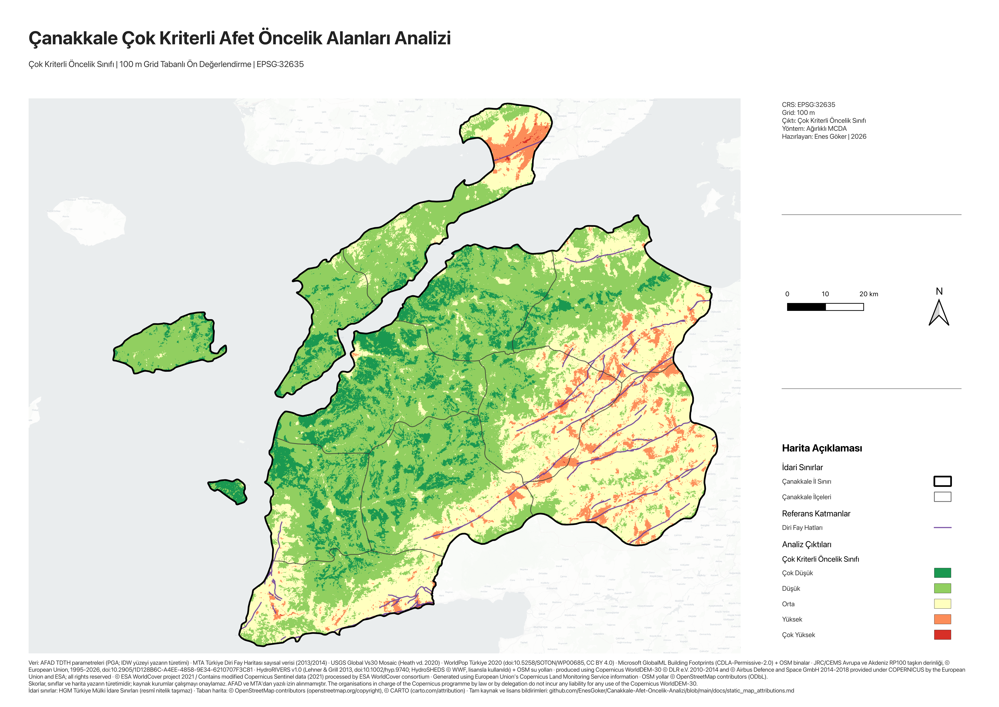
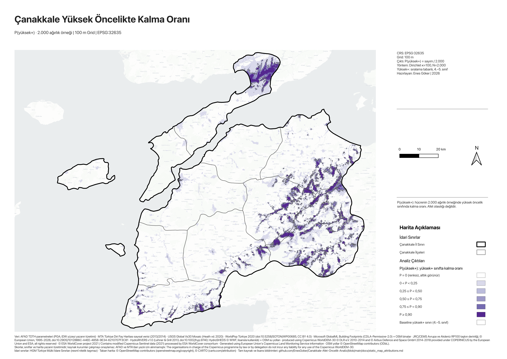

[Türkçe](README.md) | [English](README.en.md)

# Çanakkale Multi-Criteria Disaster Susceptibility and Spatial Priority Analysis

[](https://github.com/EnesGoker/Canakkale-Afet-Oncelik-Analizi/actions/workflows/tests.yml)

A GIS project that combines disaster susceptibility, population and building
exposure, and accessibility in Çanakkale province through **multi-criteria
decision analysis (MCDA) with 11 criteria** on a **shared 100 m grid**, and
compares relative priority areas across 12 districts and three weighting
scenarios.

**Project author: Enes Göker.** A student GIS portfolio from a Geographic
Information Systems course. It is an educational preliminary assessment, not
an official disaster risk, damage prediction or boundary product.

## Maps

| Final priority class (map 01) | Weight stability, P(high-plus) (map 14) |
|---|---|
| [](outputs/maps/png/01_cok_kriterli_oncelik_sinifi.png) | [](outputs/maps/png/14_yuksek_oncelik_olasiligi.png) |
| Five relative classes of the baseline model. | Share of 2,000 weight samples in which a cell stays in classes 4–5. **Not a disaster or hazard probability.** |
| Data: HGM, AFAD, MTA, USGS, WorldPop, Microsoft, JRC/CEMS, HydroSHEDS, Copernicus, ESA; © OpenStreetMap contributors, © CARTO. [Full notices](docs/static_map_attributions.md). | Data: HGM, AFAD, MTA, USGS, WorldPop, Microsoft, JRC/CEMS, HydroSHEDS, Copernicus, ESA; © OpenStreetMap contributors, © CARTO. [Full notices](docs/static_map_attributions.md). |

All 14 maps (map labels in Turkish): [map list](outputs/maps/README.md).

## Key findings

- **415.05 km²** (4.23% of the area of interest) is high or very high in all
  three weighting scenarios; **820.96 km²** is high in only one or two
  ([scenario agreement, map 13](outputs/maps/png/13_senaryo_ortakligi.png)).
- Under random weights around the baseline (Dirichlet, κ = 100), **215.75 km²**
  stays high-plus in at least 90% of samples: **39.52%** of the baseline
  high-plus area (545.92 km²).
- The baseline top-five districts keep the same set in **94.25%** of samples,
  but the same order in only **36.65%**.
- Land-cover and tree-cover criterion scores correlate at **r = 0.8152**.

"High-plus" means classes 4 and 5. These figures are not disaster
probabilities or accuracy rates.

## Known limitations

> - **Flood:** the flood score is 0 in **96.65%** of the area (source NoData
>   counted as 0; its meaning could not be verified), yet **396 of the 699**
>   very-high cells (56.7%) have a flood score above 0.
> - **Class 5 is narrow:** 699 cells, **0.07%** of the area. The threshold
>   decides it: quantile and natural-break classes give 1,962.06 and
>   939.03 km².
> - **Double counting:** land cover and tree cover (r = 0.8152) carry
>   0.06 + 0.04 of the weight.
> - **Weights** are reasoned expert choices: no AHP, survey or calibration.
>   P(high-plus) measures weight uncertainty only, and κ sets its width
>   (P ≥ 0.9: 126.19 km² at κ = 50, 296.12 km² at κ = 200).
> - **District ranks move:** Gelibolu is 2nd in the baseline but in the
>   top three in only 69.9% of samples (κ = 100).
> - **Coarse sources** are resampled to 100 m: PGA from 1,000 m IDW, Vs30
>   ≈ 1 km, flood 90 m.
> - **No validation:** not calibrated against observed losses; no building
>   vulnerability, so it is priority and exposure, not risk.
> - **Not reproducible from this repository alone:** the processed canonical
>   data are not distributed and no download route is published.

Full list: [method summary §10](docs/method_summary.en.md#10-known-limitations).

## Method in brief

Eleven criterion layers (PGA, fault proximity, Vs30, population, building
density, flood, hydrography, slope, land cover, tree cover, road access) are
aligned to EPSG:32635 and a 100 m grid of 981,033 cells. Each is transformed
to a 0–1 score and combined by a weighted linear sum; the normalized score is
shown in five equal-interval classes. Two alternative weightings, 2,000
Dirichlet weight samples with one-at-a-time changes, and model variants
(flood weight 0, merged vegetation, quantile and natural-break thresholds)
test how stable the high-priority areas are.
[Method summary (English)](docs/method_summary.en.md).

## What this repository contains

- Analysis, QA and packaging code; 465 unit tests in 27 modules.
- Weights and model definitions, aggregate result tables, the 14 map PNGs and
  a QGIS project template.
- Not included: canonical rasters and vectors, map PDFs, the atlas, and the
  Word/PDF report ([file scope](docs/publication_file_scope.md)).

From a clone alone, the unit tests, the public-scope check and the package
check run; the analyses and full QA need the canonical data folder.
[Usage, QGIS and QA](docs/usage.en.md).

## Tests and continuous integration

```bash
python3 scripts/python/run_tests.py --tiers stdlib
```

The tests build small temporary fixtures and never read the canonical data.
[`config/test_tiers_v1.json`](config/test_tiers_v1.json) assigns each module
to a runtime tier (stdlib 192, scientific 90, gdal 166, qgis 17). CI runs the
first three (gdal on macOS arm64 only); tiers, expected outputs and the locked GDAL runtime are in
[docs/usage.en.md](docs/usage.en.md#tests-and-continuous-integration).

## My contribution

- I brought together GIS layers from institutions and open data sources
  and prepared them for analysis.
- I built the MCDA model combining 11 criteria on a shared 100 m grid and
  documented the score transformations, weight rationale, and methodological
  limitations.
- I prepared the QGIS layers and map layouts and presented the results
  through district tables, a map atlas, and the course report.

**Tools and practices:** QGIS, GDAL/OGR, Python, Bash · shared CRS/grid/AOI,
relative QGIS paths, SHA-256 manifests, test cases.

## License and sources

The MIT License covers only the original software in `scripts/`. Maps,
tables, documents and data are not MIT-licensed; see the
[license scope](LICENSE_SCOPE.md#license-scope-english). Data attribution is
not permission to redistribute.
[Source inventory](docs/data_source_inventory.md) ·
[Data rights](docs/data_rights_and_distribution.md) ·
[Map notices](docs/static_map_attributions.md).

## Documentation

[Documentation index](docs/README.md#english) · [Türkçe README](README.md).
