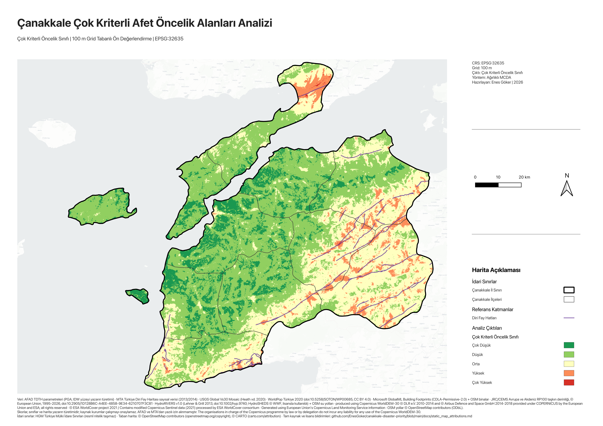
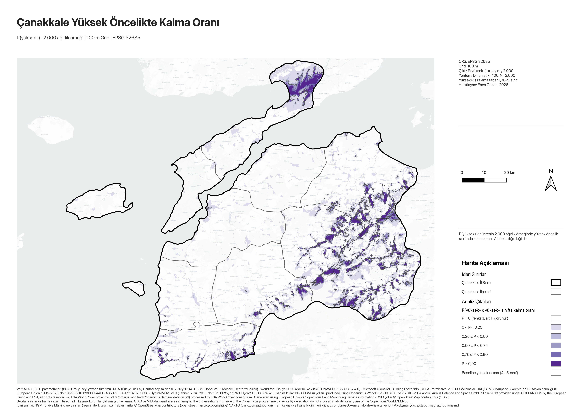

[English](README.md) | [Türkçe](README.tr.md)

# Çanakkale Çok Kriterli Afet Duyarlılığı ve Mekânsal Öncelik Analizi

[](https://github.com/EnesGoker/canakkale-disaster-priority/actions/workflows/tests.yml)

Çanakkale ili için afet duyarlılığı, nüfus ve yapı maruziyeti ile erişim
koşullarını **11 kriterli çok kriterli karar analizi (MCDA)** ile **100 m
ortak gridde** birleştiren ve göreli öncelik alanlarını 12 ilçede ve üç ağırlık
senaryosunda karşılaştıran bir CBS projesi.

**Proje sahibi: Enes Göker.** Coğrafi Bilgi Sistemleri dersi kapsamında
hazırlanmış bir öğrenci CBS portföyüdür. Eğitim amaçlı bir ön değerlendirmedir;
resmî afet riski, hasar tahmini veya sınır ürünü değildir.

## Haritalar

| Nihai öncelik sınıfı (harita 01) | Ağırlık kararlılığı, P(yüksek+) (harita 14) |
|---|---|
| [](outputs/maps/png/01_cok_kriterli_oncelik_sinifi.png) | [](outputs/maps/png/14_yuksek_oncelik_olasiligi.png) |
| Baseline modelin beş göreli sınıfı. | Hücrenin 2.000 ağırlık örneğinde 4.–5. sınıfta kalma oranı. **Afet veya tehlike olasılığı değildir.** |
| Veri: HGM, AFAD, MTA, USGS, WorldPop, Microsoft, JRC/CEMS, HydroSHEDS, Copernicus, ESA; © OpenStreetMap contributors, © CARTO. [Tam bildirimler](docs/static_map_attributions.md). | Veri: HGM, AFAD, MTA, USGS, WorldPop, Microsoft, JRC/CEMS, HydroSHEDS, Copernicus, ESA; © OpenStreetMap contributors, © CARTO. [Tam bildirimler](docs/static_map_attributions.md). |

14 haritanın tamamı: [harita listesi](outputs/maps/README.md).

## Öne çıkan bulgular

- **415,05 km²** (çalışma alanının %4,23'ü) üç ağırlık senaryosunun hepsinde
  yüksek veya çok yüksektir; **820,96 km²** yalnız bir veya ikisinde yüksektir
  ([senaryo ortaklığı, harita 13](outputs/maps/png/13_senaryo_ortakligi.png)).
- Baseline çevresindeki rastgele ağırlıklarda (Dirichlet, κ = 100)
  **215,75 km²** örneklerin en az %90'ında yüksek+ kalır: baseline yüksek+
  alanının (545,92 km²) **%39,52**'si.
- Baseline'ın ilk beş ilçesi örneklerin **%94,25**'inde aynı kümeyi korur,
  ama aynı sırayı yalnız **%36,65**'inde.
- Arazi örtüsü ve ağaç örtüsü kriter skorları arasındaki korelasyon
  **r = 0,8152**'dir.

"Yüksek+", 4. ve 5. sınıflardır. Bu sayılar afet olasılığı veya doğruluk
oranı değildir.

## Bilinen sınırlılıklar

> - **Taşkın:** taşkın skoru alanın **%96,65**'inde 0'dır (kaynak NoData 0
>   sayıldı; anlamı doğrulanamadı); yine de 699 çok yüksek hücrenin **396**'sında
>   (%56,7) taşkın skoru 0'dan büyüktür.
> - **5. sınıf dar:** 699 hücre, alanın **%0,07**'si. Onu eşik belirler: kantil
>   ve doğal kırılma sınıfları 1.962,06 ve 939,03 km² verir.
> - **Çift sayım:** arazi örtüsü ve ağaç örtüsü (r = 0,8152) ağırlığın
>   0,06 + 0,04'ünü taşır.
> - **Ağırlıklar** gerekçeli uzman seçimidir: AHP, anket veya kalibrasyon yok.
>   P(yüksek+) yalnız ağırlık belirsizliğini ölçer; genişliğini κ belirler
>   (P ≥ 0,9: κ = 50'de 126,19 km², κ = 200'de 296,12 km²).
> - **İlçe sıraları oynar:** Gelibolu baseline'da 2.'dir ama örneklerin yalnız
>   %69,9'unda ilk üçtedir (κ = 100).
> - **Kaba kaynaklar** 100 m'ye yeniden örneklendi: PGA 1.000 m IDW'den, Vs30
>   ≈ 1 km, taşkın 90 m.
> - **Doğrulama yok:** gözlenmiş kayıplarla kalibre edilmedi; bina kırılganlığı
>   yok, bu yüzden risk değil öncelik ve maruziyettir.
> - **Yalnız bu depodan yeniden üretilemez:** işlenmiş kanonik veriler
>   dağıtılmıyor ve bir indirme yolu yayımlanmadı.

Tam liste: [yöntem özeti §10](docs/method_summary.md#10-known-limitations) (İngilizce) ·
[bilimsel sınırlılıklar](docs/methodology/scientific_limits.md).

## Kısaca yöntem

On bir kriter katmanı (PGA, fay yakınlığı, Vs30, nüfus, bina yoğunluğu, taşkın,
hidrografya, eğim, arazi örtüsü, ağaç örtüsü, yol erişimi) EPSG:32635'e ve
981.033 hücrelik 100 m gride hizalanır. Her biri 0–1 skora dönüştürülür ve
ağırlıklı doğrusal toplamla birleştirilir; normalize skor beş eşit aralıklı
sınıfta gösterilir. İki alternatif ağırlık senaryosu, tek tek değişikliklerle
birlikte 2.000 Dirichlet ağırlık örneği ve model varyantları (taşkın ağırlığı 0,
birleşik vejetasyon, kantil ve doğal kırılma eşikleri) yüksek öncelik alanlarının
ne kadar kararlı olduğunu sınar.
[Güncel yöntem notu](docs/methodology/updated_mcda_methodology_note.md).

## Bu depoda ne var

- Analiz, QA ve paketleme kodu; 27 modülde 465 birim test.
- Ağırlıklar ve model tanımları, özet sonuç tabloları, 14 harita PNG'si ve bir
  QGIS proje şablonu.
- Dahil olmayanlar: kanonik rasterlar ve vektörler, harita PDF'leri, atlas ve
  Word/PDF raporu ([dosya kapsamı](docs/publication_file_scope.md)).

Yalnız bir klonla birim testler, kamu kapsamı kontrolü ve paket kontrolü
çalışır; analizler ve tam QA kanonik veri klasörünü gerektirir.
[Kullanım, QGIS ve QA](docs/usage.tr.md).

## Testler ve sürekli entegrasyon

```bash
python3 scripts/python/run_tests.py --tiers stdlib
```

Testler küçük geçici fikstürler kurar ve kanonik veriyi hiç okumaz.
[`config/test_tiers_v1.json`](config/test_tiers_v1.json) her modülü bir çalışma
katmanına atar (stdlib 192, scientific 90, gdal 166, qgis 17). CI ilk üçünü
koşar (gdal yalnız macOS arm64'te); katmanlar, beklenen çıktılar ve kilitli GDAL
ortamı [docs/usage.tr.md](docs/usage.tr.md#testler-ve-sürekli-entegrasyon) içindedir.

## Kişisel katkım

- Farklı kurumlardan ve açık veri kaynaklarından gelen CBS katmanlarını
  bir araya getirip analiz için hazırladım.
- On bir kriteri ortak 100 m gridde birleştiren MCDA modelini kurdum;
  skor dönüşümlerini, ağırlıkların gerekçelerini ve yöntemin sınırlılıklarını
  belgeledim.
- QGIS katmanlarını ve harita düzenlerini hazırladım; sonuçları ilçe
  tabloları, harita atlası ve ders raporuyla sundum.

**Araçlar ve uygulamalar:** QGIS, GDAL/OGR, Python, Bash · ortak CRS/grid/AOI,
göreli QGIS yolları, SHA-256 manifestleri, test örnekleri.

## Lisans ve kaynaklar

MIT lisansı yalnız `scripts/` altındaki özgün yazılımı kapsar. Haritalar,
tablolar, belgeler ve veriler MIT kapsamında değildir; bkz.
[lisans kapsamı](LICENSE_SCOPE.md). Veri atfı yeniden dağıtım izni değildir.
[Kaynak envanteri](docs/data_source_inventory.md) ·
[Veri hakları](docs/data_rights_and_distribution.md) ·
[Harita bildirimleri](docs/static_map_attributions.md).

## Belgeler

[Belge dizini](docs/README.md) · [English README](README.md).
